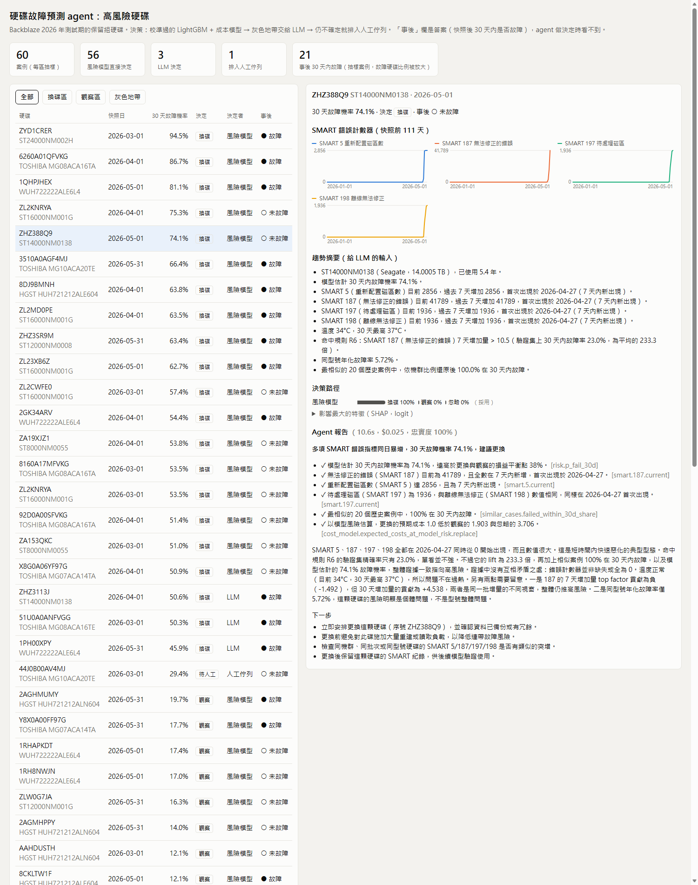

# drive-failure

**English** | [繁體中文](README.zh-TW.md)

Hard drives report health counters about themselves, called SMART: how many sectors had to be remapped, how many read errors could not be fixed, temperature, and so on. Backblaze, a cloud storage company, publishes these counters every day for its whole fleet, along with which drives failed.

This project uses that data to warn about drives that are likely to fail in the next 30 days. For each warning, it decides whether to replace the drive now, keep an eye on it, or leave it alone. It also writes a short report explaining why, and every number in the report is checked against the data.

Live dashboard: https://kjlavender.github.io/drive-failure/



## What it found

The data covers six quarters (January 2025 to June 2026): 372,456 drives and 6,861 failures. The model was trained on 2025 data and tested on the first half of 2026, using drives it had never seen.

A warning system is only useful if it doesn't cry wolf. So every result below is measured at a fixed limit: no more than about 2 false alarms per 1,000 healthy drives per month. A false alarm is a warning about a drive that then keeps working.

At that limit, the model catches about half of the failures (50%, with a likely range of 46–55%). On average the warning comes 19 days before the drive fails.

| Approach | Failures caught | False alarms per 1,000 drives per month |
|---|---|---|
| Backblaze's own rule (warn if any of 5 key counters is above zero) | 77% | 78 |
| Simple model (logistic regression) | 39% | 1.6 |
| This project's model (LightGBM, a decision-tree model) | 50% | 1.4 |

Backblaze's rule catches more failures, but it warns about 8% of all drives. Most of those drives keep working for months.

Other findings:

- How fast counters rise matters more than their current value. The most useful signals were how much counters 187 (errors the drive could not fix) and 197 (sectors waiting to be remapped) went up in the last 30 days. A drive that stops reporting SMART at all is the strongest single warning: about half of those fail within a month.
- About 1 in 5 failures gives no warning. In 21% of failures, no error counter changed in the 30 days before the drive died. SMART data cannot catch those.
- Warning earlier costs almost nothing. Looking 30 days ahead instead of 7 catches about the same share of failures (50% vs 47%), and the warnings come almost three times earlier.
- The model has to be retrained. After three quarters without retraining, the model still ranked drives about as well. But its alarm threshold drifted: it raised 26–38% more false alarms than allowed. Retraining every quarter on all past data fixed this.
- A model trained on one brand does not work on another. A model trained only on WDC/HGST drives raised 424 false alarms per 1,000 Seagate drives per month. Training on all brands together worked better than a separate model for each brand.
- Part of the labels may be circular. Backblaze sometimes replaces drives before they fail, based on the same 5 counters its rule uses. Those drives are labeled as failed. Without those 5 counters, the model catches 25% instead of 50%. So they matter, but this data cannot fully separate "they predict failure" from "they caused the failed label".
- Ceph's built-in predictor does worse here. Ceph is open-source storage software with its own failure predictor. At the same false-alarm rate, it caught 34% of failures within 14 days, compared with 76% for this model. Ceph's models were trained years ago on older drives, so this mostly shows what happens when a model is never retrained.

Full write-ups (in Chinese): [model comparison](reports/week2.md), [drift, brands, missed failures](reports/week3.md), [Ceph, drive lifespan, small-data brands](reports/week3_extra.md), [agent](reports/agent_eval.md).

## How it decides what to do

The decision step reuses judge-core from my [ops-judge](https://github.com/KJLavender/ops-judge) project. Easy cases are settled by cheap steps. Only unclear ones move on to more expensive steps:

```
facts → risk model + cost rule → LLM → human review queue
```

1. Facts. Code works out the facts first: which counters are rising and since when, which ones pushed the risk up the most, and how the 20 most similar past drives turned out. The LLM never reads raw numbers. It gets these facts and short sentences built from them, such as "SMART 197 is 1936, up 1936 in the last 7 days, first seen on 2026-04-27".
2. Risk and cost. The model gives a probability that the drive fails within 30 days. A simple cost rule turns that into an action. By default, an unexpected failure costs 5 times as much as replacing a drive early. With those numbers:
   - leave the drive alone if the risk is below 2%
   - watch it if the risk is between 2% and 38%
   - replace it if the risk is above 38%

   You can change the costs in `policies/costs.yaml`.
3. Ask only when it matters. If the risk sits right on a boundary, the model is unsure. But if the two possible actions cost almost the same, a wrong pick hardly matters, so the model decides anyway. Without this rule, 15 of 60 test cases went to a human. Almost all of them were close calls between "leave it" and "watch it", where a wrong choice cost about 1% of a replacement. With the rule, 1 of 60 went to a human.
4. Report and check. The LLM writes the report from the facts. Every point in the report has to name the fact it comes from. A checker then confirms each value and flags any number that isn't in the facts. In 30 reports, every cited value checked out and no unsupported numbers turned up. Each report took about 10 seconds and cost about $0.02. The checker only verifies numbers, though. Whether the reasoning makes sense still needs a person, and `reports/agent_human_review.csv` is the sheet for that.

The LLM runs through the local Claude Code CLI (`claude -p`), so it uses your Claude subscription and needs no API key. The default model is Sonnet. Set `DRIVEFAIL_LLM_MODEL` to change it.

Under the default costs, following these decisions lowers the total cost by 22% compared with doing nothing. Following Backblaze's rule costs 15 times more than doing nothing. This holds whether a failure costs 3 times or 20 times as much as a replacement.

## Run it

You need [uv](https://docs.astral.sh/uv/) and about 25 GB of free disk space. The agent step also needs the [Claude Code](https://claude.com/claude-code) CLI, logged in.

```bash
uv sync
bash scripts/download.sh Q1_2025 Q2_2025 Q3_2025 Q4_2025 Q1_2026 Q2_2026   # about 8 GB
uv run python -m drivefail.ingest      # unzip and convert to Parquet, one quarter at a time
uv run python -m drivefail.drives      # one row per drive, plus label checks
uv run python -m drivefail.stats       # yearly failure rate per model
uv run python -m drivefail.features    # 7- and 30-day changes, trends

uv run python -m drivefail.train       # compare the rule, logistic regression and LightGBM
uv run python -m drivefail.week3       # retraining, other brands, missed failures
uv run python -m drivefail.survival    # how long drives last, by age
uv run python -m drivefail.transfer    # new brand with little data

uv run python -m drivefail.risk        # final model and daily risk snapshots
uv run python -m drivefail.agent --dry-run   # try the decision flow without calling the LLM
uv run python -m drivefail.agent       # 60 decisions and 30 reports, about $1
uv run python -m drivefail.agent_eval
uv run python -m drivefail.dashboard   # writes docs/index.html
uv run pytest
```

The Ceph comparison needs an old version of scikit-learn. Run `uv run python -m drivefail.ceph_baseline extract`, then the command at the top of `scripts/ceph_score.py`, then `uv run python -m drivefail.ceph_baseline compare`.

## Limits

- Only hard disks. The data also has 3,516 SSDs, but none of them failed in 18 months, so there was nothing to learn from.
- The agent was tested on 60 decisions and 30 reports. The reports have not been scored by a person yet.
- The cost numbers are assumptions. Change them to match your own setup.
- Each test quarter has only 190–310 failures, so quarter-to-quarter differences of a few points may be noise.

## Layout

```
src/drivefail/
  ingest.py db.py drives.py stats.py   load the data (DuckDB over Parquet)
  features.py                           changes and trends per drive
  evaluate.py                           false alarms, failures caught, warning time
  train.py week3.py transfer.py         experiments
  survival.py ceph_baseline.py          drive lifespan, Ceph comparison
  risk.py                               final model, probability calibration, rules
  evidence.py                           facts and sentences for the LLM
  agent.py agent_eval.py                decisions, reports, report checking
  dashboard.py dashboard_template.html  the dashboard page
policies/                               decision settings and costs
reports/                                results and charts
scripts/                                data download, Ceph scoring
tests/
```
