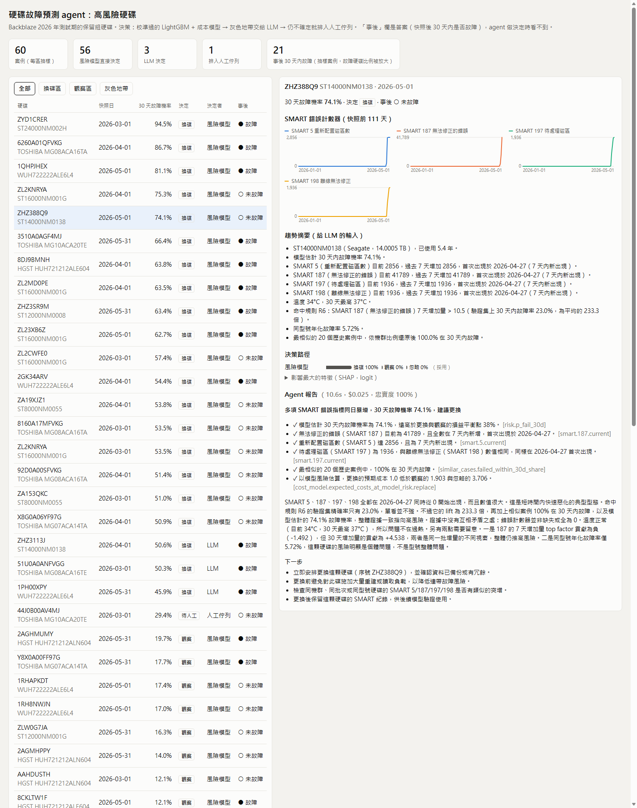

# drive-failure

[English](README.md) | **繁體中文**

用 Backblaze 公開的 SMART 資料預測哪些硬碟快壞了，再讓 agent 決定每顆該怎麼處理（換碟、觀察、忽略），並寫出每個數字都查得到出處的報告。

大部分公開的 Backblaze 專案只做到「模型 X 的 AUC 是 Y」。這個專案著重的是決定它能不能用在維運的部分：依時間切分並保留沒看過的硬碟、在固定誤報預算下看偵測率、模型放久了或遇到新廠牌會怎樣，以及預測之後要做什麼。



## 結果總覽

Backblaze Drive Stats 共 6 季（2025 Q1 – 2026 Q2）：372,456 顆硬碟、1.8 億個 drive-days、6,861 次故障。測試集：2026 上半年、訓練時沒看過的硬碟（503 次故障）。

| 問題 | 答案 |
|---|---|
| 在可接受的誤報率下能抓到多少故障？ | 每 1000 顆健康硬碟每月誤報 1.4 顆時，30 天內的故障抓到 **50%（95% CI 46–55%）**。Backblaze 自己的規則（SMART 5/187/188/197/198 任一不為 0）抓到 77%，但每 1000 顆每月誤報 78 顆，是預算的 40 倍。 |
| 能提早多久？ | 平均提早 18.8 天。預警期從 7 天拉到 30 天，偵測率幾乎不變（47% → 50%），提前天數卻多了 3 倍。 |
| 哪些 SMART 指標重要？ | 187 和 197 的「30 天增加量」比它們的當前值更重要。最強的單一訊號是硬碟連 SMART 都讀不到（48% 在 30 天內故障）。 |
| 模型是不是只是學會 Backblaze 的換碟規則？ | 部分無法回答。Backblaze 的故障標籤包含主動汰換，而汰換依據正是這 5 個指標。拿掉它們偵測率減半（50% → 25%），代表它們確實有訊號，但這個實驗分不出是「有預警力」還是「標籤由它們產生」。 |
| 模型放久了會退化嗎？ | 排序能力撐得住，**門檻**撐不住。凍結三季的模型，每季實際誤報都超出預算 26–38%。每季用全部歷史重訓就能守住預算。 |
| 換廠牌還準嗎？ | 不準。排序能力掉 2–9 倍，門檻也不能沿用（WDC/HGST 的模型用在 Seagate，每 1000 顆每月誤報 424 顆）。所有廠牌一起訓練，比各廠牌自己的模型好。 |
| SMART 看不到什麼？ | 21% 的故障在故障前 30 天，沒有任何錯誤計數器有變化（業界常引用約 23%）。 |
| 和 Ceph 內建的預測模組比？ | 同誤報率下偵測率 76% vs 34%（14 天預警期）。Ceph 的模型是多年前用舊硬碟訓練的，所以這主要顯示的是「從不重訓」的代價。 |
| 照著做能省錢嗎？ | 在預設的成本模型下，模型 + 依成本選動作，比什麼都不做省 22% 的事後成本；Backblaze 規則的成本是什麼都不做的 15 倍。故障成本從換碟的 3 倍到 20 倍，結論都成立。 |

細節：[Week 2](reports/week2.md) · [Week 3](reports/week3.md) · [Ceph／存活分析／遷移學習](reports/week3_extra.md) · [Agent](reports/agent_eval.md)

## Agent 怎麼決定

決策層沿用 ops-judge 的 [judge-core](https://github.com/KJLavender/ops-judge)：先用便宜的方法，看不清楚的才往下送。

```
證據整理層 → 風險模型 + 成本模型 → LLM（claude -p）→ 人工佇列（SQLite）
```

1. **證據整理層**（`evidence.py`）。LLM 不直接讀原始 SMART 數字。程式先算好事實：哪些計數器在上升、從哪天開始、SHAP 貢獻、命中的規則、同型號故障率、最相似的 20 個歷史案例後來怎樣。再寫成固定格式的中文趨勢句（「SMART 197 目前 1936，過去 7 天增加 1936，首次出現於 2026-04-27」）。每個事實都有固定的 key，例如 `smart.197.change_7d`。
2. **風險模型 + 成本模型**（`agent.py`、`policies/costs.yaml`）。校準過的 30 天故障機率 *p* 決定每個動作的期望成本。預設成本（非計畫故障 = 換碟的 5 倍）下：*p* < 2% 忽略、2–38% 觀察、> 38% 換碟。信心度的算法：假設風險估計在對數勝算上可能偏 ±0.5，看動作會不會因此改變。
3. **成本感知的升級。** 如果最佳和次佳動作的期望成本差不到 0.02，選錯也沒什麼差別，就由模型直接決定。沒有這條規則時，60 個抽樣案例有 15 個送到人工，幾乎都是 *p* ≈ 2% 時「忽略 vs 觀察」的選擇，選錯的代價大約只有換碟的 1%。加上之後只剩 1 個送到人工。每案事後成本多了 0.012，仍在 0.02 的容忍範圍內，LLM 花費降為 1/15。
4. **報告 + 忠實度檢查。** LLM 根據證據寫報告。每條發現都必須引用證據 key，檢查器會核對數值，並標出文字裡任何在證據中找不到的數字。30 份報告：發現 100% 驗證通過、0 個無出處數字，每份 9.5 秒、$0.023（透過本機 Claude Code CLI 用 Sonnet）。檢查器只涵蓋有引用的數字，定性的說法仍需要人看：評分表在 `reports/agent_human_review.csv`。

## 執行

需要 [uv](https://docs.astral.sh/uv/)、約 25 GB 磁碟空間（zip 8 GB、Parquet 6 GB，加上一次解壓一季的 CSV）；agent 部分需要登入的 [Claude Code](https://claude.com/claude-code) CLI（走訂閱，不需要 API key）。

```bash
uv sync
bash scripts/download.sh Q1_2025 Q2_2025 Q3_2025 Q4_2025 Q1_2026 Q2_2026   # 約 8 GB
uv run python -m drivefail.ingest          # zip → 逐日 Parquet（每季 11 GB CSV → 約 800 MB）
uv run python -m drivefail.drives          # 每顆硬碟一列 + 標籤品質檢查
uv run python -m drivefail.stats           # 各型號、各季 AFR
uv run python -m drivefail.features        # 視窗特徵，依硬碟抽樣

uv run python -m drivefail.train           # Week 2：規則 vs 邏輯斯迴歸 vs LightGBM vs 消融
uv run python -m drivefail.week3           # 漂移、跨廠牌、錯誤案例、信賴區間
uv run python -m drivefail.survival        # 左截斷修正的 Kaplan–Meier、Cox
uv run python -m drivefail.transfer        # 新廠牌少量資料的遷移學習

uv run python -m drivefail.risk            # 部署用模型、校準、規則萃取、快照
uv run python -m drivefail.agent --dry-run # 不呼叫 LLM 跑一次 cascade
uv run python -m drivefail.agent           # 60 個案例 + 30 份報告（約 $1）
uv run python -m drivefail.agent_eval
uv run python -m drivefail.dashboard       # → site/index.html
uv run pytest
```

Ceph 對照需要舊版 scikit-learn：先跑 `uv run python -m drivefail.ceph_baseline extract`，再跑 `scripts/ceph_score.py` 開頭那行 `uv run --python 3.8 ...`，最後跑 `... ceph_baseline compare`。用環境變數 `DRIVEFAIL_LLM_MODEL` 切換模型（預設 `claude-sonnet-5-5`）。

## 限制

- **只有 HDD。** 資料中 3,516 顆 SSD 在 18 個月（184 萬 drive-days）內沒有任何故障，沒東西可訓練。已發表的 SSD 研究（阿里巴巴、騰訊）依賴這份資料沒有的磨損指標。
- **標籤循環只量化，沒有解決。** 見上面的消融實驗。
- **Agent 評估規模小。** 60 個決策、30 份報告，人工評分表還沒填。成本模型的數字是假設，`policies/costs.yaml` 本來就該依實際情況修改。
- **逐季比較的雜訊大。** 每季測試只有 190–310 次故障（偵測率 ±6–7 個百分點），各種重訓策略的差異大多落在這個範圍內。

## 目錄

```
src/drivefail/
  ingest.py db.py drives.py stats.py   資料管線（DuckDB 查 Parquet）
  features.py                           視窗特徵、依硬碟抽樣
  evaluate.py                           誤報預算、偵測率、提前天數、bootstrap 信賴區間
  train.py week3.py transfer.py         實驗
  survival.py ceph_baseline.py          存活分析、Ceph 對照
  risk.py                               部署用模型、校準、規則萃取
  evidence.py                           證據整理層（事實 + 趨勢句）
  agent.py agent_eval.py                judge-core cascade、報告、忠實度、評估
  dashboard.py dashboard_template.html  靜態 dashboard
policies/                               judge-core policy 與成本模型
reports/                                結果（Markdown、CSV、圖）
scripts/                                下載、Ceph 評分（舊 sklearn 環境）
tests/
```
