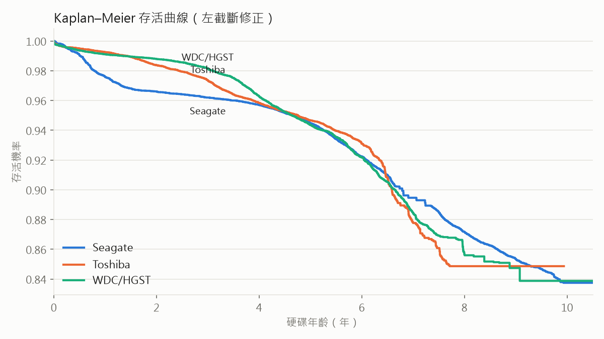
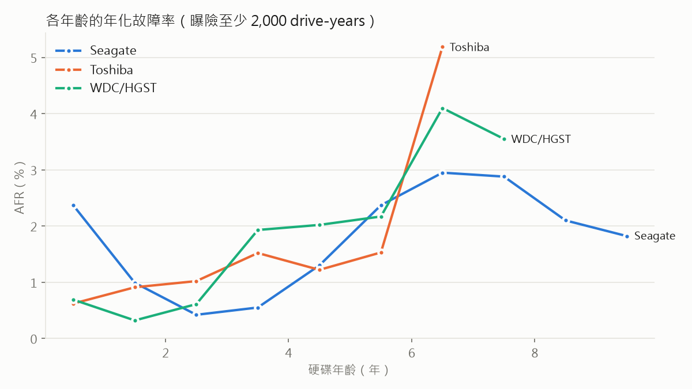

# Week 3 選做：Ceph 對照、存活分析、遷移學習

## 1. 對照 Ceph diskprediction_local（Red Hat 模型）

Ceph 內建的本地預測模組。我們抓官方 repo 的模型檔（`models/redhat/`，scikit-learn 0.19 時代的 RandomForest），
在 Python 3.8 + scikit-learn 0.23 的獨立環境裡跑（`scripts/ceph_score.py`），特徵轉換照抄原始碼。
唯一改動：原碼在「6 天平均為 0、標準差非 0」時變異係數會變成 inf 並報錯，改成補 0。

- Ceph 輸出 `Bad`（< 2 週）、`Warning`（2–6 週）、`Good`（> 6 週）
- 只有 Seagate 與 `HGST` 開頭的型號有模型（`WDC …` 開頭會是 Unknown），比較只用這兩群：3103 顆硬碟、299 顆故障
- 我們的 LightGBM 在驗證集上調到「和 Ceph 相同的誤報率」再比

| 模型 | N | 誤報／1k／月 | 偵測率 | 提前天數 |
|---|---|---|---|---|
| Ceph（Bad） | 14 | 20.6 | 33.8% | 9.7 |
| LightGBM（同誤報率） | 14 | 17.9 | **76.3%** | 11.8 |
| LightGBM（預算 2） | 14 | 1.3 | 50.2% | 9.8 |
| Ceph（Bad 或 Warning） | 30 | 28.8 | 43.8% | 20.7 |
| LightGBM（同誤報率） | 30 | 28.6 | **79.9%** | 24.8 |
| LightGBM（預算 2） | 30 | 0.6 | 44.8% | 17.7 |

同誤報率下偵測率約為 Ceph 的 2 倍；誤報少 16 倍時仍比 Ceph 抓得多。
**公平性說明**：Ceph 模型是多年前用舊的 Backblaze 資料、舊型號訓練的，從未針對 2026 年的機群更新。
這個差距多半是「模型沒重訓」造成，正好呼應 Week 3 的漂移結論，而不代表 Ceph 方法本身差。

## 2. 存活分析

- 年齡 = SMART 9 通電時數；**左截斷**：硬碟進入資料集時已經用了幾年，用 lifelines 的 `entry` 修正
- 事件 = 故障；消失但沒標故障 = 右設限；排除復活序號、SSD
- 364,295 顆 HDD，6,747 次故障

| 廠牌 | 硬碟 | 故障 | S(3 年) | S(5 年) | S(7 年) | S(5 年)，忽略左截斷 |
|---|---|---|---|---|---|---|
| Seagate | 115,229 | 2,664 | 0.962 | 0.945 | 0.895 | 0.989 |
| Toshiba | 125,809 | 1,991 | 0.974 | 0.947 | 0.878 | 0.977 |
| WDC/HGST | 123,257 | 2,092 | 0.982 | 0.944 | 0.885 | 0.978 |

**發現**
- **忽略左截斷會嚴重高估壽命**：5 年存活率 0.98–0.99 vs 修正後 0.944–0.947。早夭的硬碟根本沒機會進入資料集，不修正就看不到它們。
- **只有 Seagate 有早夭期**：第 0 年 AFR 2.4%，第 2–3 年降到 0.4–0.6%，之後上升——接近浴缸曲線。Toshiba 與 WDC/HGST 則是單調上升。
- **磨損期從第 5–6 年開始**：三個廠牌在 6 歲左右 AFR 都升到 3–5%。8 歲以上看似下降，是倖存者效應加上曝險變少。
- **Cox 模型：控制年齡後，廠牌之間沒有顯著差異**（Toshiba HR 1.01、WDC/HGST HR 1.01，相對 Seagate，p > 0.7；容量 HR 1.003/TB，p = 0.34）。各廠牌 AFR 的差異主要來自**機群年齡組成**不同。
  - 注意：三條風險曲線在早期交叉（Seagate 早夭），比例風險假設不完全成立，HR 只能解讀為整個年齡範圍的平均。

## 3. 遷移學習：新廠牌只有少量資料時

模擬目標廠牌只有 5%／10%／25%／100% 的訓練硬碟（其他廠牌完整），四種策略。門檻與 early stopping 用目標廠牌驗證集。

PR-AUC（測試集，不受門檻影響）：

| 目標 | 資料比例 | 只用其他廠牌 | 只用目標 | 混合訓練 | 預訓練 + 微調 |
|---|---|---|---|---|---|
| WDC/HGST | 0% | 0.082 | – | – | – |
| | 5% | | 0.086 | 0.096 | **0.116** |
| | 10% | | **0.149** | 0.085 | 0.114 |
| | 25% | | **0.161** | 0.100 | 0.145 |
| | 100% | | 0.162 | **0.173** | 0.159 |
| Toshiba | 0% | 0.035 | – | – | – |
| | 5% | | 0.070 | **0.101** | 0.076 |
| | 10% | | 0.095 | **0.106** | 0.045 |
| | 25% | | 0.074 | **0.138** | 0.046 |
| | 100% | | 0.144 | **0.171** | 0.168 |

**結論**
- **完全不用目標資料最差**：再次確認跨廠牌不能直接用。
- **混合訓練最穩**：Toshiba 每個比例都最好，兩個廠牌在 100% 時都最好。
- **微調不穩定**：WDC/HGST 5% 時最好，但 Toshiba 10%／25% 時崩到 0.045。小資料下 early stopping 的驗證集本身也很小，容易選錯停止點。
- 每個目標只有 131–168 顆測試故障，偵測率 CI 約 ±7 個百分點；實際誤報率常偏離預算（小驗證集選門檻不準），所以以 PR-AUC 為主。
- **實務建議**：新廠牌上線時預設混合訓練；資料極少時可試微調，但必須用獨立驗證集監控。
